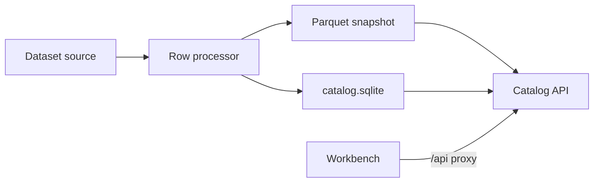
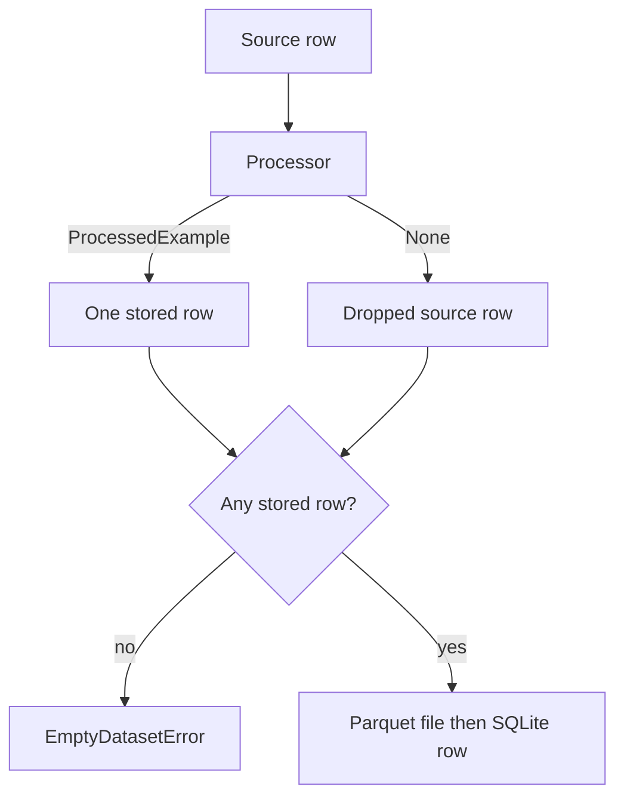
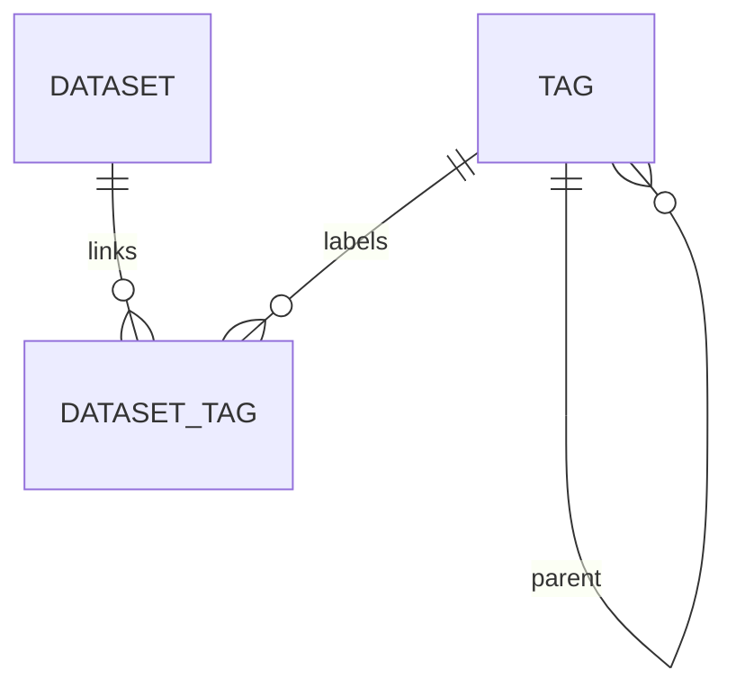

# Architecture

Registration and browsing are separate processes. Python writes the catalog. The API and the workbench only read it, except for tag creation and tag links.

The workbench never opens SQLite or Parquet. In development, Vite forwards `/api` to `http://127.0.0.1:8000` and removes the `/api` prefix. See [Runtime configuration](../configuration/runtime.md).

## What a registration writes

`DatasetRepository.register` reads the source, runs the processor, writes `datasets/<id>/rows.parquet`, then inserts the dataset and its tag links. If the insert fails, it deletes that Parquet file. Tag nodes must already exist. `create_tag` and `POST /tags` create nodes. They do not attach those nodes to a dataset.

`rows_loaded` counts source rows. `rows_kept` counts stored rows. `rows_dropped` counts source rows whose processor returned `None`. Because one source row becomes at most one stored row, `rows_kept + rows_dropped` equals `rows_loaded`.

The diagram omits validation that happens before the read: an empty name, a bad `limit`, a duplicate dataset name, or a missing tag path. Those failures leave no snapshot. Field rules are in [Stored snapshot](../data/snapshot.md).

## Catalog relationships

SQLite in `catalog.sqlite` is the index. Parquet holds the rows. This diagram matches that index. It does not show Parquet columns.

A tag has at most one parent. A dataset links to many tags, and a tag labels many datasets. Deleting a tag requires no child tag and no dataset link. Listing datasets for a tag includes datasets linked to that tag or to a tag under it. The dataset record stores only the tags linked directly to it.

## Process boundaries

| Piece | Runs as | Owns |
| --- | --- | --- |
| `llm_evaluation_hub.core` | Library inside the registering process and the API process | Snapshots, tags, conversation records |
| Catalog API | `uvicorn` factory `llm_evaluation_hub.api.asgi:app` | HTTP reads, tag creation, tag links |
| Workbench | React Router dev server or static build | Pages at `/datasets` and `/datasets/:id` |

The API process and a registration script can open the same catalog directory. SQLite commits one connection at a time. The workbench does not take a lock of its own.

Initialization and seed publication share a Linux kernel lock, while ordinary connections perform only connection settings and transactions. Metadata list reads batch tag links. Workbench routes share root catalog data and use immutable IDs for links. [Backup and recover](../how-to/backup-and-recover.md) defines the SQLite/Parquet transaction boundary and the supported filesystem/durability scope.
