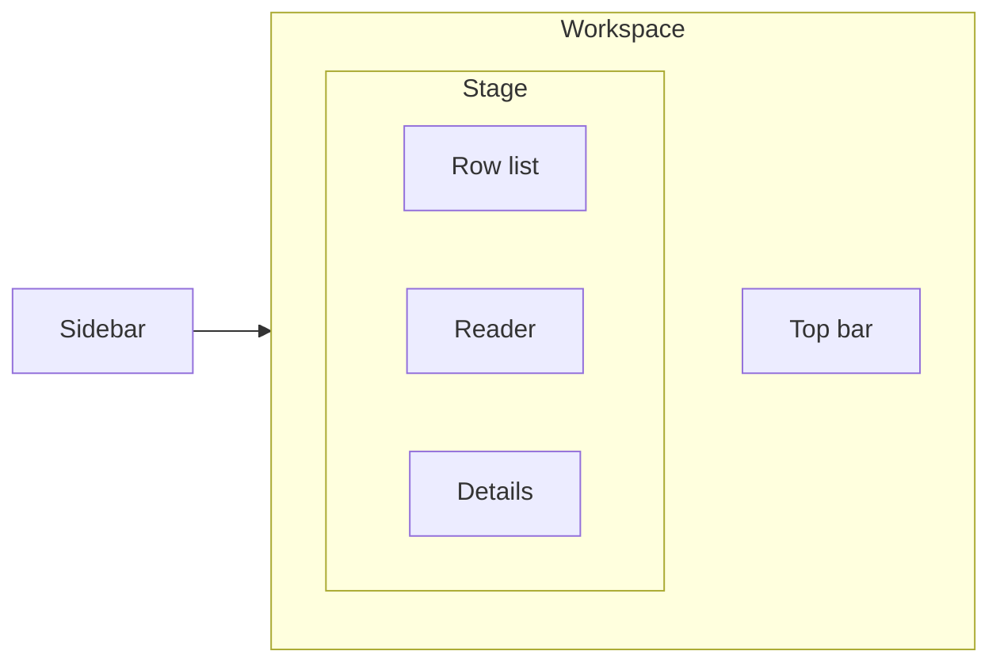

# Workbench design

The workbench is a light, dense operator tool. Page behavior, routes, and shortcuts are in [Workbench](workbench.md). This page owns color, type, layout, and what a visual change must keep. All of it lives in `web/app/app.css`. There is no Tailwind theme and no second stylesheet.

## Layout

The shell is a full-viewport grid. The sidebar is the navigation spine. The workspace is the only scrolling surface for the task.

On `/datasets` the stage is the dataset table, not the three inspector columns. The row list, reader, and details exist only on `/datasets/:name`. Details are hidden until the user opens them. The dataset page starts with the sidebar collapsed so the conversation gets the width.

| Region | Open size | Collapsed |
| --- | --- | --- |
| Sidebar | `--sidebar` (248px), tint `--gray-1` | 52px icon rail |
| Top bar | 52px, white, bottom hairline | stays |
| Row list | 280px, right hairline | removed with `\` |
| Reader | remaining width, page tint `--gray-1` | stays |
| Details | `--aside` (300px), left hairline | overlay below 1100px when open |

The sidebar is a tinted gray column, not a black column. Nested tags use a 1px guide on the left. The active nav item and the selected row each carry a 2px inset bar in the accent color. That bar is the selection mark. Do not add a second selection style.

Below 1100px the row list narrows to 240px, segment chips in the reader bar hide, and an open details pane overlays the reader. Below 768px the sidebar stacks above the page, the summary counts hide, and the inspector becomes one column with the row list capped at 260px.

## Color

Neutrals are OKLCH, hue 250. One accent is teal, hue 195. Danger is only for errors.

| Token | Value | Use |
| --- | --- | --- |
| `--gray-0` | `oklch(100% 0 0)` | Page and reader cards |
| `--gray-1` | `oklch(97.6% 0.003 250)` | Sidebar, reader background, expected-output strip |
| `--gray-2` | `oklch(94.8% 0.004 250)` | Hover, row dividers, skeleton |
| `--gray-3` | `oklch(91% 0.005 250)` | `--line` |
| `--gray-4` | `oklch(86% 0.006 250)` | `--line-strong`, retention fill |
| `--gray-6` | `oklch(62% 0.01 250)` | `--text-3` hints |
| `--gray-7` | `oklch(50% 0.012 250)` | `--text-2` |
| `--gray-9` | `oklch(30% 0.014 250)` | Secondary content |
| `--gray-10` | `oklch(21% 0.014 250)` | `--text` |
| `--accent` | `oklch(48% 0.12 195)` | Selection, focus, assistant role |
| `--accent-hover` | `oklch(43% 0.12 195)` | Selected tag and row number |
| `--accent-tint` | accent at 10% | Selected tag, selected row, active collapsed tag |
| `--danger` | `oklch(52% 0.17 25)` | Field errors and the catalog alert |

`color-scheme` is `light`. There is no dark theme.

Accent is for focus rings, the active nav item, the selected tag, the selected row, and the assistant role label. The retention bar stays gray. Counts, dates, and percents stay neutral. A new control reuses `--accent` or a neutral. It does not add another hue.

## Type

IBM Plex Sans is the UI face. IBM Plex Mono is for ids, counts, dates, tag paths, tool calls, and JSON. Both are loaded from `@fontsource` in `web/app/root.tsx`.

| Role | Spec |
| --- | --- |
| Body | 14px, weight 400, line-height 1.5 |
| Page title | 15px, weight 600, letter-spacing `-0.01em` |
| Section label | 12px, weight 500, color `--text-2` |
| Mono | 12.5px, `tabular-nums` |
| Reader prose | max 80ch, line-height 1.6 |

Headings and table headers are sentence case. Numbers use tabular figures. Do not introduce a third type family.

## Controls

| Control | Spec |
| --- | --- |
| Icon button | 26px, Lucide, stroke 1.75 |
| Ghost button | 30px, 1px `--line-strong`, white fill. Pressed state is `--gray-2`. |
| Text input | 30px in the sidebar, 28px in the row filter. Focus is an accent border plus a 3px tint ring. |
| Filter chip | 26px, hairline, removable `×` |
| Segment facet | 22px, hairline. Pressed state uses the accent tint. |
| Tool call | Mono text in a 4px-radius chip on `--gray-1` |
| Conversation card | 8px radius, 1px `--line`. Expected output sits on `--gray-1`. |
| Default radius | `--radius` is 6px. Chips use 4px. The retention bar uses 3px. |

There is no filled primary button. The dataset table row is the primary action, and the whole row is the hit target. Empty states use an icon, a title, and one sentence. The first-run state includes the `repo.register` call. Errors use `--danger` on a tinted panel, with `role="alert"`.

`:focus-visible` is a 2px accent outline. Do not remove it when restyling a control.

## Motion

Hover and color changes are 120ms. The sidebar width is 180ms. Easing is `--ease` (`cubic-bezier(0.2, 0, 0, 1)`). A loading workspace fades to opacity 0.55 after 150ms. `prefers-reduced-motion: reduce` disables animations and transitions. Do not add entrance or scroll motion in the table or the row list.

Styles are imported in explicit cascade order by `web/app/app.css`: base, shell, workspace, catalog, empty/error states, inspector and final loading/responsive overrides. Feature styles live in `web/app/styles/`; preserve that import order when moving rules. Browser regression tests capture inspector layouts at 1440, 1100 and 768 pixels with reduced motion.
