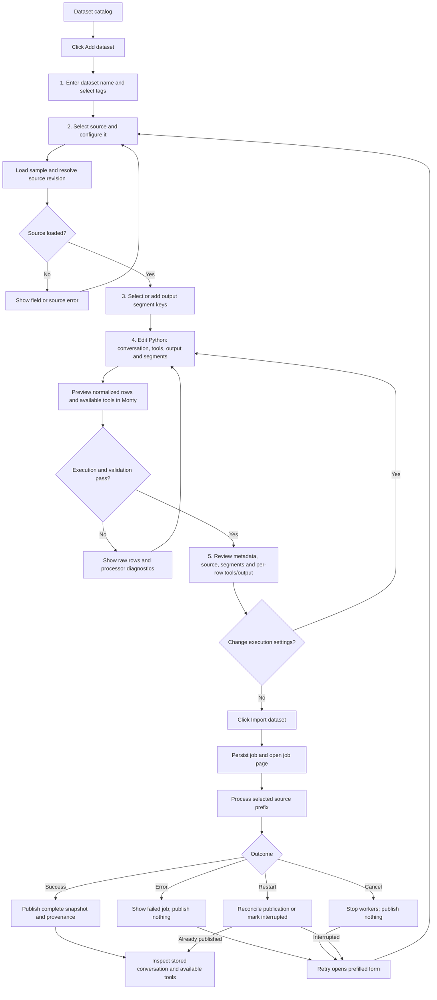

# Dataset addition: canonical implementation plan

**Status:** Implemented and verified locally under the approved plan. This file is the single source of truth and supersedes earlier chat plan exports and the separate tools amendment. It integrates the full form flow, row-level tool definitions, storage compatibility, implementation units, owners, models and reasoning settings. Completion is tracked below and evidence is recorded in the local execution trail.

## 1. Goal and complete flow

A user can enter dataset metadata, select and inspect a source, declare segments, write a Python processor, preview its output and available tools, and import an immutable dataset snapshot. Available tools are defined independently by the processor for each row, alongside conversations, outputs and segments.

Agreed scope: local trusted users, Hugging Face first, up to 10,000 source rows, CodeMirror editor, Monty execution, durable jobs, cancellation, fail-on-error behavior, and manual retry after interruption.

**Segments are output dimensions defined by the processor.** The form declares their keys and can generate starter code from selected source columns. Python determines each row’s segment values.



Use a five-step form at `/dataset-imports/new`, with a visible step indicator and **Back / Continue** navigation. Keep values when moving between steps. Completed steps remain editable; execution-setting changes invalidate downstream sample/preview state as described below.

### Step 1 — Dataset details

| Field | Control | Behavior |
|---|---|---|
| Dataset name | Required text input | User enters the catalog name, such as `turkish-support-cases`. Trim surrounding whitespace; require a nonempty, unique name. |
| Tags | Searchable hierarchical multiselect | Select existing tag paths; show selections as removable chips. Optional. |
| Source | Select | Initially contains Hugging Face. Source-specific controls appear in Step 2. |

Show name errors beside the field. Check current catalog availability before continuing, then recheck at job submission and publication to handle concurrent changes.

Tags classify the whole dataset. Segments describe individual examples. Explain that distinction beside the controls.

Do not silently attach the catalog’s currently selected tag. New tag creation remains in the existing tag-management flow.

### Step 2 — Source configuration and sample

For Hugging Face:

| Field | Control | Default or requirement |
|---|---|---|
| Repository | Required text input | Hub dataset ID, such as `organization/dataset` |
| Config | Optional text input | Source default when blank |
| Split | Required text input | `train`; plain split name |
| Revision | Text input | `main` |
| Source-row limit | Integer input | 10,000; allowed range 1–10,000 |

**Load sample** resolves the revision to a commit SHA and loads the first 10 rows, or fewer when the selected limit/source is smaller.

Display:

- Requested revision and resolved commit.
- Source column names and observed value types.
- A selectable raw JSON row viewer.
- The number of sampled rows.
- Source/authentication errors with an actionable message.

Only enable **Continue** after source loading succeeds. Backend credentials remain backend configuration; the form has no token field.

Changing repository, config, split, revision, or row limit invalidates the sample and processor preview. Preserve the user’s code and segment declarations, but require a fresh sample.

### Step 3 — Segment selection

Provide a **Segments** section with two ways to declare output keys:

1. **Choose source-column suggestions:** check sampled top-level columns to seed same-named output keys.
2. **Add a computed segment:** enter a custom key, such as `difficulty_bucket`, whose value the processor will calculate.

Selected keys appear as removable chips. Empty selection is valid.

Validate against the existing segment rules: unique keys, valid identifier syntax, and no reserved snapshot-column names. Disable invalid source-column suggestions and explain that a valid custom output key can still be added.

For example:

| Selected output key | Starter-code suggestion |
|---|---|
| `language` | `str(row["language"])` |
| `category` | `str(row["category"])` |
| `difficulty_bucket` | A marked placeholder to replace with custom logic |

The UI must state: **“Your processor must return exactly these segment keys, with a string value for each.”**

Users select segment **keys**, not all possible values. Values such as `Turkish`, `English`, or `hard` come from processing each row.

### Step 4 — Processor editor and preview

Generate the initial template after segment selection:

```python
def process(row: dict) -> dict | None:
    # Return None to intentionally skip a source row.
    return {
        "conversation": [
            {"role": "user", "content": row["text"]}
        ],
        "tools": [],
        "expected_output": row["label"],
        "segments": {
            "language": str(row["language"]),
            "difficulty_bucket": "REPLACE_ME",
        },
    }
```

The user edits input-column references, conversations, per-row available tools, expected output, extras, segment calculations, and skip logic.

Show the raw sample beside the CodeMirror editor, with the declared segment keys above it. Include contract help and the supported-Python limitations.

Controls:

- **Run preview**
- **Rebuild starter template**
- **Back**
- **Continue to review**, enabled after a valid preview

Do not silently rewrite user code when segment selections change. Mark the preview stale and show the updated key declaration. Rebuilding the template is an explicit action that warns before replacing edited code.

Preview shows each sampled row as:

- **Kept:** normalized conversation, available tools, expected output, extras, and segment values.
- **Skipped:** processor returned `None`.
- **Failed:** source-row index, safe error message, and code location where available.

Highlight syntax/runtime diagnostics in the editor. Editing clears stale diagnostics and invalidates the successful preview.

**All sampled rows may legitimately be skipped.** Allow that preview to pass with a prominent warning; the full import still fails if it retains zero rows. This avoids rejecting processors whose first matching example occurs after the sample.

### Available tools in the editor, preview and inspector

The base template includes tools: []. An explicitly selected Tools example shows row.get("tools", []), JSON-string parsing with json.loads, or custom per-row construction. Never silently rewrite user code or infer a tools column. Replacing edited code through template selection requires an explicit UI action. Show source tool data beside the editor.

Preview and stored inspector show Available tools with count/names and expandable descriptions, strict flag and parameter-schema JSON. Empty lists show No tools. Change row-specific state when selecting another row; never leave definitions from the previous row visible. Render escaped text only. Review stays row-selectable rather than implying a shared union. JSON mode and copy include complete definitions. No dataset-wide tools picker is added.

### Step 5 — Review and submit

Display a read-only summary with **Edit** links:

- Dataset name and tags.
- Source repository/config/split.
- Requested revision and pinned commit.
- Source-row limit.
- Declared segment keys.
- Processor source/hash.
- Sample kept/skipped counts and normalized examples including available tools for each selected row.
- Fail-on-error behavior and the warning that sample results do not guarantee full-import success.

Enable **Import dataset** only when the current execution configuration has an unexpired valid preview and metadata passes validation.

After submission, navigate to `/dataset-imports/{id}`. Preserve the form after submission errors. Prevent duplicate clicks; retrying the same accepted request returns the existing job.

## 2. Runtime, persistence, and API design

### Source and processor boundaries

Use:

**Trusted source adapter → bounded JSON rows → Monty → `ProcessedExample` validation → staged result → catalog publication**

A small typed registry owns supported source kinds. Hugging Face is the only initial adapter. Accept Hub repository identifiers, not arbitrary URLs, local paths, builders, dependency declarations, or client-controlled loader options.

Use a UI-specific streaming adapter pinned to the sampled SHA. Streaming bounds consumed rows, not necessarily downloaded bytes for every format; deadlines and data limits remain necessary.

Change internal `process_rows` to accept an iterable of row dictionaries. Existing Python registration passes its DataFrame row iterator. UI imports pass streamed JSON rows directly, avoiding input coercion through a DataFrame.

Let processing return an empty result with counts; enforce “at least one retained row” at snapshot publication. Existing Python registration must retain its observable zero-row failure behavior.

### Row-level available-tool contract

Add typed ToolDefinition/FunctionDefinition distinct from ToolCall/FunctionCall, and ProcessedExample.tools as a list with default empty. Omission means []; explicit null is invalid. Each row owns its complete ordered list independently; no dataset-global inheritance or union.

V1 canonical definitions use type=function and a function object containing required nonempty name and parameters JSON object, optional description string, optional strict boolean. Reject extra envelope/function fields and duplicate names within one example. Preserve nested finite JSON schemas, including $defs and $ref, under existing size/depth limits. Validate envelope/JSON content; full JSON Schema dialect validation and argument validation are out of scope. Never fetch references, execute tools, or expose them as Monty capabilities. Normalize alternate source formats in processor code. Existing historical tool calls need not have matching definitions.
Canonical definition example:

```json
{
  "type": "function",
  "function": {
    "name": "lookup_order",
    "description": "Look up an order by identifier",
    "parameters": {
      "type": "object",
      "properties": {"order_id": {"type": "string"}},
      "required": ["order_id"]
    }
  }
}
```

Tools template example, explicitly selected rather than silently applied:

```python
def process(row: dict) -> dict | None:
    return {
        "conversation": row["messages"],
        "tools": row.get("tools", []),
        "expected_output": row.get("expected_output"),
        "segments": {"language": str(row["language"])},
    }
```

### Snapshot format and legacy compatibility

Extend the planned catalog schema-v2 migration with per-dataset snapshot_format_version. Existing datasets use format 1; new registrations use format 2. Do not rewrite old Parquet at startup. Format 2 has a JSON-encoded tools column. Reserve tools for new format-2 segment declarations, without changing permissive legacy decoding. A format-1 segment named tools remains segments["tools"], while example.tools is empty. Never infer format from column presence. Missing/malformed format-2 tools is corruption, not an empty fallback. Reject unknown future formats.

Preserve tools in processing, Parquet, Python examples(), API pages, preview responses, frontend runtime parsers, inspector and clipboard. Existing Python callers omitting tools keep working. Extend processor contract versioning for tools; invalidate incompatible preview attestations. Existing backup/seed database and snapshot copying must preserve versions and tool definitions.

### Monty execution policy

Use the locked pure-Monty runtime with an explicit executable path. Start with `pydantic-monty==1.3.0` and its locked dependencies, verified by the feasibility unit.

- Fresh session per row; warm worker processes may be reused.
- Pass rows as inputs, never interpolated into code.
- No host functions, objects, external modules, mounts, or OS callbacks.
- Fixed clock/random seed; sleeps are no-ops.
- Discard prints; never forward them to application logs.
- Accept JSON-compatible inputs and dictionary-or-`None` outputs only.
- Validate outputs through `ProcessedExample`, including tools. Definitions remain plain JSON data, never host capabilities.
- Discard sessions after every row and failure.
- Never fall back to CPython or `exec`.

These boundaries follow Monty’s documented [security model](https://pydantic.dev/docs/monty/concepts/security/).

Initial server-controlled limits:

| Setting | Default |
|---|---:|
| Source rows | 10,000 maximum |
| Sample rows | 10 maximum |
| Processor source | 64 KiB |
| Individual input/output, including tools | 1 MiB each |
| Aggregate imported input/output | 128 MiB each |
| JSON nesting | 64 |
| Monty allocation budget | 64 MiB |
| Execution per row | 250 ms |
| Worker request timeout | 3 seconds |
| Recursion depth | 100 |
| Source-sample or processor-preview deadline | 30 seconds, including waiting |
| Import deadline after starting | 10 minutes |
| Sample/preview validity | 1 hour |
| Queued imports | 20 maximum |

### Source samples and preview attestations

Separate source inspection from processor execution so users can discover columns before writing code.

- Source sampling returns a sample ID, pinned coordinates, raw rows, and column summaries.
- Keep bounded samples in a server-memory cache for one hour, with at most ten samples. Eviction or restart requires reloading the source sample.
- Processor preview executes against that cached sample.
- Persist successful preview attestations without raw sample rows.
- Attestations bind source SHA/configuration, row limit, processor hash, segment keys, processor-contract version, and runtime-policy version. The contract version includes tools semantics; incompatible attestations cannot authorize imports.
- Accepted imports copy the complete execution specification into their job record; sample-cache expiry cannot invalidate an accepted job.

### API interfaces

| Interface | Purpose |
|---|---|
| `GET /dataset-sources` | Supported sources and effective limits |
| `POST /dataset-source-samples` | Resolve source and return a bounded sample |
| `POST /dataset-previews` | Execute code against a sample and return normalized results/attestation |
| `POST /dataset-imports` | Submit preview ID, dataset name, tags, and idempotency key; return `202` |
| `GET /dataset-imports` | Rediscover jobs |
| `GET /dataset-imports/{id}` | Specification, state, progress, diagnostics, and result |
| `POST /dataset-imports/{id}/cancel` | Request cancellation |
| `GET /datasets/{id}/processor` | Read processor provenance, or explicit absence |

Extend existing example and preview responses with typed tools. Runtime-parse responses as well as generating TypeScript declarations. Only the API owner regenerates shared declarations; never edit generated types manually. No separate tools-management endpoint is introduced.

Errors identify category, safe message, row index, field path such as tools[0].function.parameters, and processor line/column where available. Exclude credentials, validation input payloads, host paths, and processor locals.

### Durable jobs and publication

Use the existing catalog SQLite database for jobs, preview attestations, and provenance.

One supervisor owns a catalog-specific runner lock. Allow one active import and one active sample/preview operation. Spawn heavy operations in child process groups; cancellation, deadlines, shutdown, and parent death must clean up descendants, including Monty workers.

Job states: `queued`, `running`, `cancelling`, `succeeded`, `failed`, `cancelled`, and `interrupted`.

The child stages the processed result. The parent alone publishes:

- Serialize cancellation against publication.
- If cancellation wins, terminate processing and publish nothing.
- If publication wins, return the completed terminal state.
- Insert dataset metadata, provenance, and job success in the same SQLite transaction.
- Keep filesystem staging identifiable by job/candidate dataset ID for crash cleanup.
- On restart, reconcile any published result before marking active attempts interrupted.
- Preserve queued jobs; do not automatically resume interrupted attempts.

Retry opens the five-step form prefilled from the previous specification. Require a fresh sample and preview, then create a new job.

Persist processor source/hash, contract/runtime/policy versions, source coordinates/SHA, and import ID. Existing snapshots and Python callers remain valid without processor provenance.

## 3. Implementation units, owner models and dependencies

Primary owns scope, contracts, integration and acceptance in this chat; do not spawn a duplicate orchestrator. Owners preserve others' edits, own their tests and report evidence. Shared-file ownership is exclusive and handed off explicitly. The table records the models used so far. Per the latest user instruction, all remaining implementation, verification and review work uses gpt-6.1-terra; security and quality review use High reasoning.

| Unit | Owner | Model | Reasoning | Responsibility, dependencies and acceptance |
|---|---|---|---|---|
| **0. Contract freeze** | Primary agent | Current chat | Unchanged | Freeze form/source/example/tool/preview/job/error/provenance models, snapshot versions and service signatures. Assign migration, lockfile, generated-output, fixture and lifecycle-wiring ownership before parallel edits. |
| **1. Monty feasibility** | `sandbox-runtime` | `gpt-6.1-sol` | Medium | Depends on 0. Own runtime/tests and Monty pyproject/uv.lock changes. Prove real capability denial, nested tools and output budgets, session isolation, limits, crash recovery, Linux/WSL and Python 3.12 Docker support; measure 10k rows. Isolation failure stops integration with no weaker fallback. |
| **2. Core and persistence** | `catalog-core` | `gpt-6.1-sol` | Medium | Depends on 0. Own typed definitions, iterable processing, tools encode/decode, schema-v2/snapshot migration, shared publication, provenance and transactional job completion. Test legacy tools segments, defaults, errors, heterogeneous rows, atomicity/concurrency, backup/restore and seed preservation. |
| **3. Source and preview** | `import-source-api` then `source_api_finish` | `gpt-6-luna` then `gpt-6.1-sol` | Medium | Depends on 0-2. Own registry, UI streaming HF adapter, sample cache, preview/attestation service and tests. Prove exact SHA/prefix/order, nested JSON preservation, expiry/invalidation, skips, field errors, limits and no preview publication. |
| **4. Durable jobs** | `import-backend` | `gpt-6.1-sol` | Medium | Depends on 0-3. Own job engine/store via catalog interfaces, supervisor/process groups, admission/idempotency/progress, cancellation/publication arbitration and restart/shutdown. Own lifecycle integration files. Prove responsive reads, descendant cleanup and crash/race results. |
| **5. API transport** | `import-source-api` then `source_api_finish` | `gpt-6-luna` then `gpt-6.1-sol` | Medium | Depends on 3-4. Own routes/request-response/error models, API tests and generated declarations. Wire agreed job/lifecycle interfaces without independently editing lifecycle-owned files. Prove real API/Monty/catalog round-trips and replay. |
| **6. Five-step UI** | `import-frontend` | `gpt-6-luna` | High | Skeleton after 0; integration after 5. Own form/editor/routes/styles, npm lockfile, runtime parsers, catalog links, templates/help, preview/review and inspector tools. Prove preserved edits, invalidation, exact per-row tools and JSON/copy, escaped text, keyboard behavior and legacy routes. |
| **7. Jobs UI** | `import-frontend` | `gpt-6-luna` | High | Depends on 5-6; reuse owner. Own jobs list/detail, polling, acknowledged cancellation, retry prefill and catalog revalidation. Refresh restores state; success opens UUID inspector; failure history remains discoverable. |
| **8. System verification** | `integration-qa`, then `terra_qa` | `gpt-6-luna`, then `gpt-6.1-terra` | High, then Medium | Depends on 1-7. Own synthetic external-source fixtures and real API/jobs/Monty/storage browser tests. Prove complete success/error/recovery journeys, row-varying schemas, old formats, keyboard/responsive behavior. Report application defects to owners. |
| **9. Documentation** | `import-docs` | `gpt-6-luna` | Medium | After 1-8 stabilize. Own scoped record/snapshot/API/workbench/configuration/registration/recovery/code-map updates. Explain definitions versus calls/results, row ownership, canonical shapes, validation limits and non-execution; verify examples/links. |
| **10a. Security review** | `terra_security` | `gpt-6.1-terra` | High | After implementation/verification stabilize. Independently review source/sandbox boundaries, worker cleanup, resource policy, publication races, corruption and legacy decoding. Return actionable evidence-backed findings. |
| **10b. Quality review** | `quality-review`, then `terra_quality` | `gpt-6-luna`, then `gpt-6.1-terra` | High | Alongside 10a. Independently review structure, ownership, contract drift, frontend state and maintainability. Escalate unresolved material questions to primary. |

Primary completes final acceptance and reports passed, failed, blocked and unrun checks. Implementation units have been dispatched using the model assignments above; verified completion is tracked in the execution checklist.
Use CodeMirror 6 directly, without a React adapter. Enable Python highlighting, line numbers, undo/redo, bracket matching, four-space indentation, and backend diagnostics. Preserve editor selection/history across renders, clean up on unmount, and keep Tab/Shift+Tab as focus navigation.

Routes:

- `/dataset-imports/new`: five-step form.
- `/dataset-imports`: persisted job list.
- `/dataset-imports/:id`: progress and result.

Add entry points in the dataset header and empty state. This route namespace avoids shadowing existing dataset-name URLs.

## 4. Verification and delivery sequence

Run at most three subagents alongside the primary agent:

1. **Foundation:** sandbox runner, catalog core, and frontend form/editor skeleton in parallel.
2. **Integration:** source/preview and job-engine owners follow their dependencies; API owner wires stable services; frontend integrates generated transport. Respect the three-subagent limit.
3. **Verification:** QA exercises the complete system while owners address defects.
4. **Handoff:** documentation, two independent final reviews, scoped fixes, and final repository checks.

Required observable scenarios:

- Enter a name, select multiple tags, configure HF, and inspect raw source columns.
- Select source-derived segment keys and add a computed key; verify generated starter code.
- Go backward, change keys, and confirm custom code is preserved and preview invalidated.
- Preview normalized conversations, available tools and segment values, then import and inspect identical semantics.
- All sample rows skipped but later rows retained; all import rows skipped fails publication.
- A later invalid row fails the entire import without a partial snapshot.
- Syntax errors, source/auth failures, unsupported values, sandbox limits, stale/expired samples, and duplicate names.
- Duplicate submission, cancellation races, refresh, application restart, and manual retry.
- Editor typing, paste, undo, reset, focus navigation, and shell-shortcut suppression.
- Layouts at 1440, 1100, and 768 pixels.
- Row 1 offers lookup_order, row 2 search_catalog, row 3 no tools; exact lists/schemas survive preview, publication, API reads, inspector and copy.
- Omitted/empty tools, Unicode, nested schemas and JSON-string source tools normalized by code work.
- Explicit null, malformed envelope, invalid parameter-object type, non-JSON/non-finite contents and duplicate names fail clearly.
- A later-row definition error fails the complete import without partial publication.
- Tool definitions confer no filesystem/network/host-call capability and are never executed or remotely resolved.
- Old rows without tools and old tools-named segments remain readable; corrupt format-2 definitions fail rather than disappear.
- Backup/restore and starter catalogs retain definitions and format identity; existing assistant calls and tool results still render.
- New tools output counts toward per-row/aggregate/depth limits; run real Monty tests rather than only mocks.
- Existing Python registration, browsing, tags, backup/restore, and legacy links remain functional.

Run the documented Python, frontend, generated-contract, documentation, and browser checks. Add one bounded public-HF smoke outside network-free CI.

### Token-conscious delegation

Budget rules: use targeted handoffs with fork_turns=none and explicit model/reasoning instead of copying full conversation history. Supply only the relevant plan sections, authoritative paths, frozen interfaces, constraints and acceptance checks. Reuse each owner for related followups. Implement frontend and source/API work in bounded verifiable units; do not launch one agent per file. Keep the primary plus at most three active subagents. Run the required checks once per relevant change, reuse valid evidence, and avoid duplicate exploration and status polling. Keep successful reports concise: changed paths, checks, defects and remaining limits. Run independent final reviews once after the implementation stabilizes.

Escalation: first send concrete test/reproduction evidence back to the current owner for a focused repair. Use gpt-6.1-terra for all remaining implementation, verification and review tasks. Use Medium reasoning for implementation and High for security/quality review. Escalate only that unit and transfer its bounded evidence/context; do not rerun the whole project with a larger model. Do not use Astra or ultra/max reasoning by default. Runtime capability and publication safety checks remain required regardless of model choice.

### Implementation gate

Implementation passed the real Monty feasibility gate, integrated feature checks, independent reviews and the packaged Python 3.12 Docker smoke. Benchmark and verification evidence are recorded in the local execution trail. This canonical file replaces earlier exports; update its owning sections in place rather than appending another plan.


## Execution checklist and frozen integration contracts

- [x] Inspect current workspace and establish approved Linux/WSL command execution; preserve all pre-existing edits.
- [x] Freeze the integration contract below and assign first-wave ownership.
- [x] Unit 1: real Monty runner and feasibility evidence. 25 runtime tests pass on Python 3.14; 24 passed on 3.12; 10k nested-tool rows in 4.549 seconds. A Python 3.12 Docker image was built and passed isolated runtime, tool, denial/resource and API startup smoke checks.
- [x] Unit 2: tools/format migration, iterable processing and atomic import persistence. Core/seed suite 77 passed; final affected records/imports suite 35 passed; focused Ruff/ty passed. Legacy tools segment preserved.
- [x] Units 3/5: source, preview and API integration. 69 source/API tests passed before final replay regression; remote-only installed-loader regression and public HF smoke passed.
- [x] Unit 4: durable supervision, cancellation and recovery. 14 real-process tests passed, including both race winners, parent-death cleanup and independent lanes; focused lint/format/ty passed.
- [x] Units 6/7: full UI/editor/inspector and job integration. Type/lint/format/production build and 10 frontend unit tests passed; shared tool panel preserves existing control names.
- [x] Unit 8: real system verification and regression checks. Full production Chromium suite 15/15 passed, including delayed-request races, unchanged legacy catalog tests and 1440/1100/768 form layouts. Screenshots visually inspected by primary.
- [x] Unit 9: documentation updated; checker passes for 17 documents.
- [x] Unit 10: independent Terra security and quality reviews completed; confirmed findings were fixed and targeted follow-ups found no remaining concrete issue. Final Python 192 tests, frontend 10 tests, browser 15 tests, lint, format, type, contract and documentation checks passed.

### Unit 0: Frozen handoff interfaces

Application modules live under src/llm_evaluation_hub/imports/. Runtime owner exclusively owns imports/runtime.py (and any cohesive runtime helper), runtime tests, and Monty pyproject/uv.lock edits. Primary writes imports/contracts.py before API integration; it contains API/service models, not persistence. Source/API owner owns imports/sources.py, imports/previews.py, api/import_routes.py and API schema generation. Job owner owns imports/jobs.py, imports/worker.py and app lifecycle wiring. Frontend owns its feature/routes/styles/parsers/npm lockfile; no other owner edits frontend files except generated api-schema.ts by the API owner. Core owner owns catalog persistence/migrations, processing, records and their tests.

Source request: source={kind:"hf_dataset",repo_id,config:null,split:"train",revision:"main"}, row_limit integer 1-10000. Sample response: id, source (same coordinates), resolved_sha, row_limit, rows (plain JSON dictionaries), columns=[{name,types:[string]}], expires_at. POST /dataset-source-samples accepts {source,row_limit}. POST /dataset-previews accepts {sample_id,source_code,segment_keys}. Preview response: id (null if failed), sample_id, resolved_sha, source_hash, rows=[{source_index,status:"kept"|"skipped"|"failed",example:ProcessedExample|null,error:Diagnostic|null}], rows_kept, rows_dropped, valid, expires_at. Source-sample rows are available from step 2; processor previews need not duplicate raw data. All-skipped samples can be valid. Diagnostic fields: category,message,source_index:null,line:null,column:null,field_path:null. Do not emit raw validation inputs.

POST /dataset-imports accepts {preview_id,name,tags:[],idempotency_key}; returns job with 202. Job fields: id,name,state,phase,rows_loaded,rows_kept,rows_dropped,created_at,updated_at,dataset_id:null,error:null,spec. Immutable job spec: source,row_limit,resolved_sha,source_code,source_hash,segment_keys,tags,processor_contract_version:"2",runtime_policy_version:"1",runtime_version; name is on job. GET /dataset-imports returns {jobs:[...]}; GET /dataset-imports/{id} returns job; cancellation returns authoritative job (terminal is idempotent). GET /dataset-sources returns {sources:[{kind:"hf_dataset",label:"Hugging Face"}],limits:{max_rows:10000,sample_rows:10,max_source_bytes:65536}}. GET /datasets/{id}/processor returns {provenance:object|null}. Field-level HTTP validation uses existing FastAPI 422; import-domain errors use structured Diagnostic under detail. Conflict=409; busy=429; unavailable=503; source/processor validation=422; unknown/expired sample/preview=404/410.

Sandbox callable boundary: with ProcessorRunner(source_code) as runner: example=runner.process(row). process returns validated ProcessedExample or None, throws ProcessorError with diagnostic-safe category/message/line/column/field_path; no source index until caller adds it. Expose runtime_version and source_hash. Runtime stays independent of HTTP, jobs and source adapters. Source/API owner supplies bounded streamed rows; child job runner passes them through process_rows and stages the ProcessResult frame.

Core owner provides public persistence interfaces: register_processed(name,result,descriptor,*,processor_id,tags,segments,limit,provenance,dataset_id,import_id) for parent-only publication (result=ProcessResult, descriptor=SourceDescriptor); ordinary register shares publication. Provenance is finite JSON and optional; supplied import_id completes an existing job in that same metadata transaction. Provide get_processor(dataset_id)->dict|null. New ImportStore(root) owns SQLite jobs and successful-preview attestations without scheduler/runtime dependencies: put_preview(id,spec,expires_at), get_preview(id), create_job(name,spec,idempotency_key)->job dict, get_job(id), list_jobs()->list[dict], update_job(id,**state/progress fields), recover_interrupted(), and cancellation/publication transition serialization exposed to the scheduler. Jobs return exactly the frozen wire fields plus internal candidate_dataset_id/idempotency data as needed. Store creates no schema independently: core migration owns tables. Core tests prove transactional completion and legacy snapshot interpretation.

Before publication the child must be finished/stopped and the supervisor must hold the cancellation/publication decision lock. Never hold that lock during child/network waits. The parent alone invokes register_processed. API owner and job owner coordinate through the frozen service boundary rather than both editing app.py. When richer typed domain interfaces improve these signatures, notify primary and migrate callers in the same unit.

### Supervisor/source service handoff

Source/API owner implements SourceAdapter protocol: resolve(source:SourceSpec)->str and rows(source:SourceSpec,resolved_sha:str,limit:int)->Iterator[dict[str,object]]. HuggingFaceAdapter stores no live client object and is picklable; resolve constructs HfApi inside the worker. Validate/resolve actual Hub IDs before invoking load_dataset, avoid interpreting built-in loader names as source datasets, pin SHA and use streaming=True; do not accept client loader kwargs. Trusted synthetic adapter injection via create_app is test-only and never an HTTP capability.

Source/API owns worker-callable collect_sample(adapter,source,row_limit)->dict with resolved_sha,rows,columns (plain JSON), and execute_preview(rows,source_code,segment_keys)->dict with source_hash,runtime_version,rows,rows_kept,rows_dropped,valid. Parent PreviewService(store,supervisor) caches SampleView, calls supervisor.run_operation(kind,payload,timeout=30), persists successful attestations and exposes sample(SampleRequest)->SampleView and preview(PreviewRequest)->PreviewView. Operation kinds are sample and preview; sample payload is SampleRequest JSON, preview payload includes cached rows/source_code/segment_keys. Job owner supplies run_operation and imports these worker callables inside the child dispatcher. A preview failure still shows cached raw rows in the UI. Use public runtime validate_json_budget to share size/JSON policy; processing.require_segments owns segment equality.

Job owner implements ImportSupervisor(root,source_adapter=None): start(),stop(),run_operation(kind,payload,timeout=30)->dict,submit(name,spec,idempotency_key)->wire job dict,get_job,list_jobs,cancel. start/stop are bound to create_app lifespan; source_adapter injection defaults to HuggingFaceAdapter and is a trusted constructor-only option. API app.state.import_supervisor and app.state.preview_service hold those services. API owner provides api.import_routes.router and api.include import schemas in export_contract.py; job owner alone edits app.py for lifespan, router inclusion and service construction once available. API owner handles validation sanitization through an exported handler installed by job owner, avoiding simultaneous app.py edits.

Samples/previews have one active lane independent of one durable import lane. Operation timeouts include semaphore wait; timed-out operations release/kill process groups, never leave background work consuming slots. Worker stages imports under catalog tmp/imports/{job_id}/ with fixed owned paths; parent reconstructs ProcessResult and invokes register_processed under store.decision_lock(). Candidate dataset ID is the persisted job candidate_dataset_id. No network/child wait inside decision lock. Store returns internal keys that API JobView excludes deliberately rather than extra=forbid failure.
